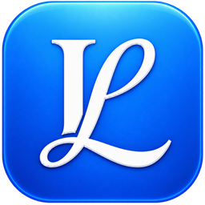
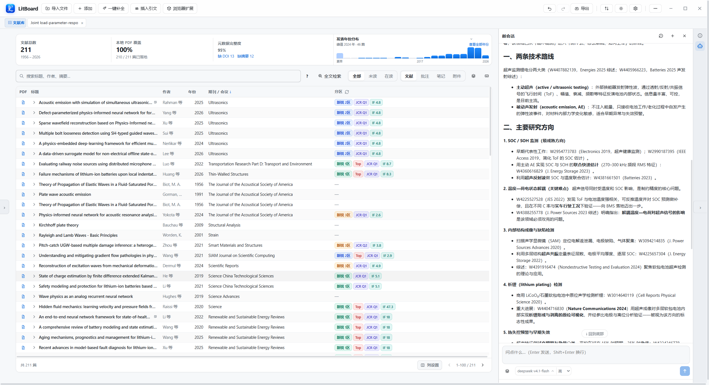
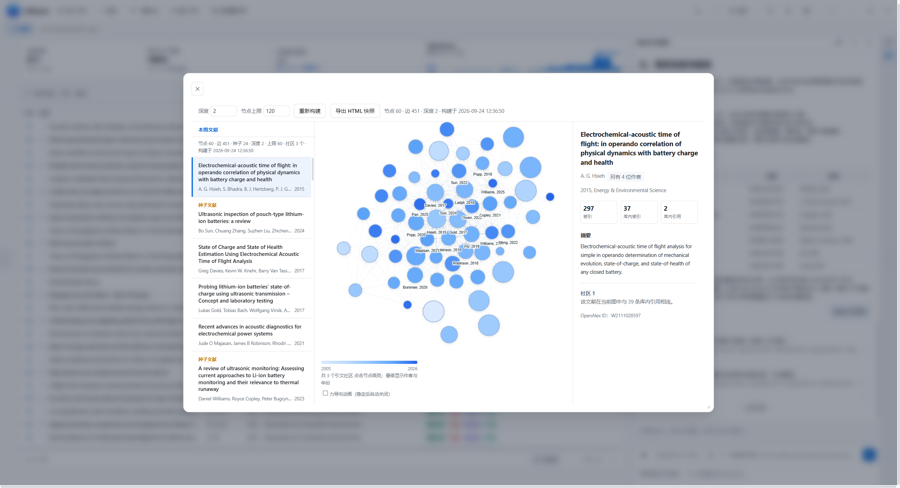
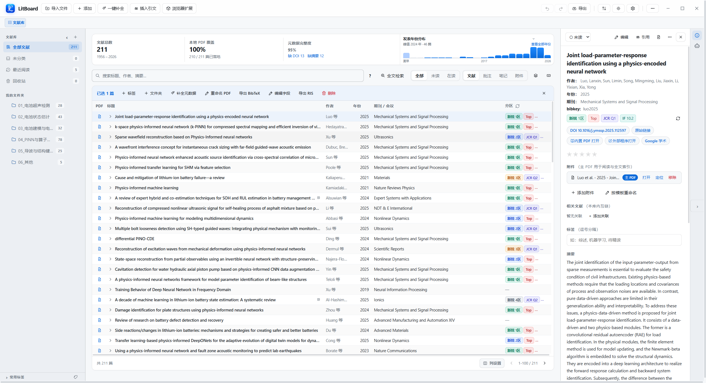
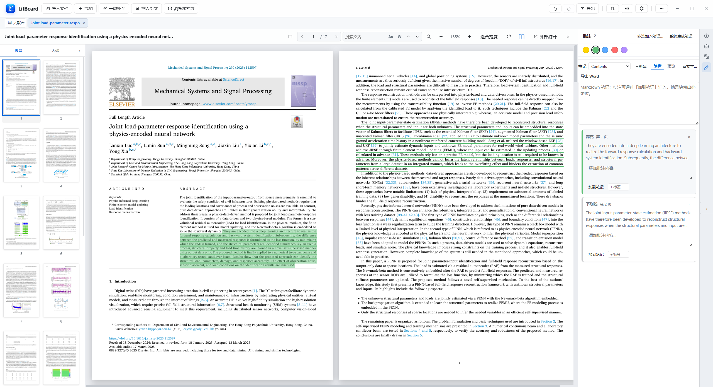
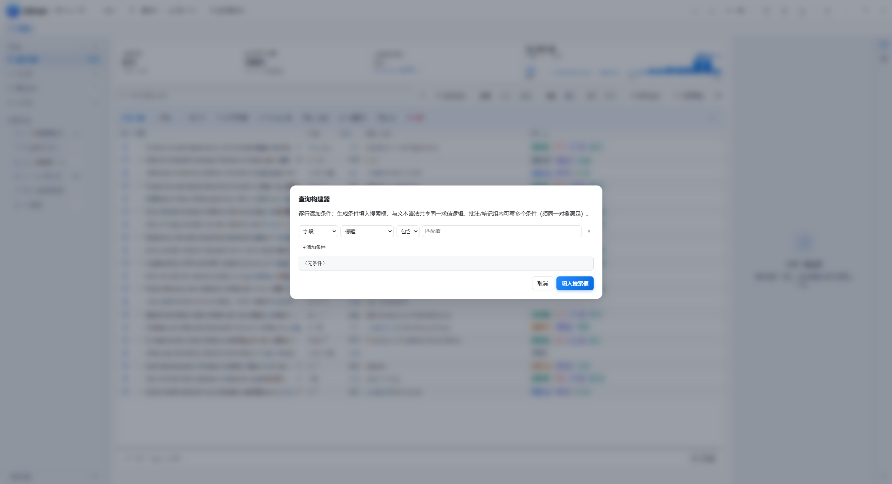
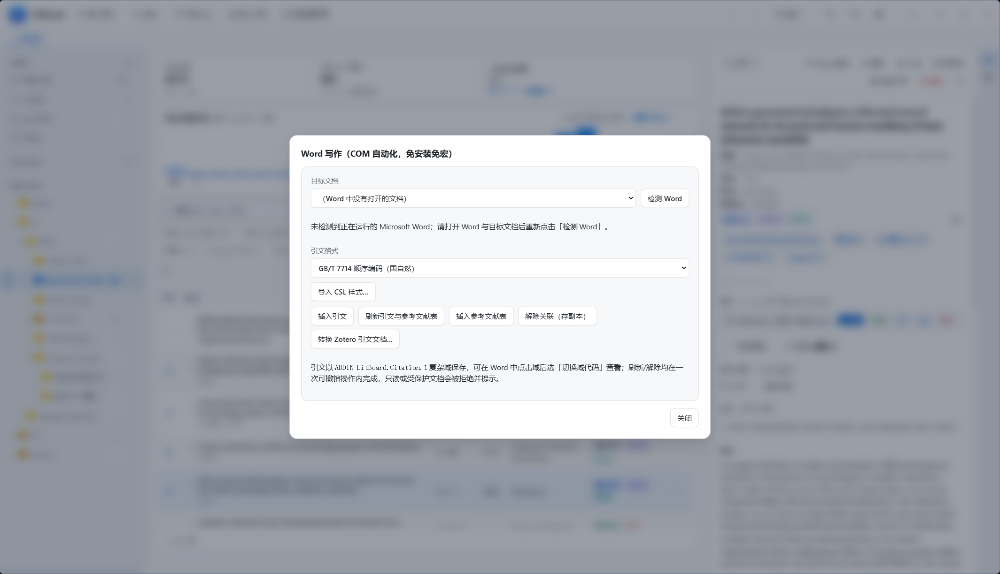

<div align="center">



# LitBoard

**A local literature workspace built around an AI research assistant**

**English** · [简体中文](README.zh-CN.md) · [Feature tour (Chinese)](docs/feature-tour.md) · [Download for Windows](https://github.com/L1nze/LitBoard/releases)

[](LICENSE)
[](#get-started)

</div>

LitBoard combines a local literature library, PDF / EPUB reader, citations, and an AI research assistant on Windows. Nutstore sync and model services are optional.

## Screenshots

Light-theme examples: AI conversation and citation graph from a test session; other screens use demo data. Click to enlarge.

<table>
  <tr>
    <td width="33.3%" align="center"><a href="docs/assets/screenshots/agent.png"></a><br><strong>AI research assistant</strong></td>
    <td width="33.3%" align="center"><a href="docs/assets/screenshots/citation-graph.png"></a><br><strong>Citation network</strong></td>
    <td width="33.3%" align="center"><a href="docs/assets/screenshots/library.png"></a><br><strong>Library and details</strong></td>
  </tr>
  <tr>
    <td width="33.3%" align="center"><a href="docs/assets/screenshots/reader.png"></a><br><strong>PDF reading</strong></td>
    <td width="33.3%" align="center"><a href="docs/assets/screenshots/search.png"></a><br><strong>Combined search</strong></td>
    <td width="33.3%" align="center"><a href="docs/assets/screenshots/citation.png"></a><br><strong>Citation previews</strong></td>
  </tr>
</table>

## Features

- Import files, folders, or a local Zotero library; detect duplicates and preserve local edits.
- Read PDF, EPUB, and snapshots; annotate, take notes, run OCR, and search indexed content.
- Ask the AI assistant to read selected pages, find literature, inspect evidence, and build citation graphs. Vision models can inspect rendered PDF pages.
- Insert and refresh CSL citations and bibliographies in Word.
- Keep the main library locally, create snapshots, and optionally sync through Nutstore WebDAV.

AI research data is separate from the main library; collecting papers requires confirmation. You configure model credentials; online tools contact external services. Manual literature search works without an AI model. Design background: [PAPER-SQL](https://github.com/galois-yan/PAPER-SQL).

## Get started

Download a Windows x64 installer or portable build from [GitHub Releases](https://github.com/L1nze/LitBoard/releases); see the [download guide](docs/release.md) for checksums. Packaged builds need no Node.js.

1. Import PDF, BibTeX, RIS, CSL-JSON, or a document folder. For Zotero, use **Settings → Integrations → Zotero local library**.
2. Configure the AI endpoint, model, and credentials if needed; embedding has a separate configuration.
3. Set a snapshot location in **Data & backup**; add Nutstore WebDAV for cross-device sync.

Folder import supports PDF, EPUB, DjVu, MOBI, AZW3, DOC, DOCX, ODT, and RTF. Drop onto a collection to import there, or elsewhere to use the selected collection. See the [feature tour](docs/feature-tour.md).

For Chrome / Edge capture, load the unpacked `resources/extension/` from an installation or `extension/` from source. Enable LitBoard's **Extension** receiver and copy its port and token into extension options.

## Data and updates

Data defaults to `%APPDATA%\LitBoard`; you can choose another directory. Snapshots support restore. Updates download in the background and require a matching SHA-256 checksum; **Update now** launches the installer, or locates the new portable file for replacement. Current builds are unsigned.

## Run from source

Node requirements and tool versions are in [package.json](package.json). Tools install outside the repository under `%LOCALAPPDATA%\LitBoardBuildTools`; no project `node_modules`.

```powershell
npm.cmd test
npm.cmd run lint
npm.cmd start
npm.cmd run dist:nobump
```

`npm run dist` increments the patch version. See [development](docs/development.md), [release workflow](docs/releasing.md), and the [documentation index](docs/README.md).

## License and third-party components

LitBoard's own code uses [MIT](LICENSE). MuPDF.js uses AGPL-3.0-or-later; bundled components retain their own terms. See the [third-party inventory](docs/THIRD-PARTY.md).
