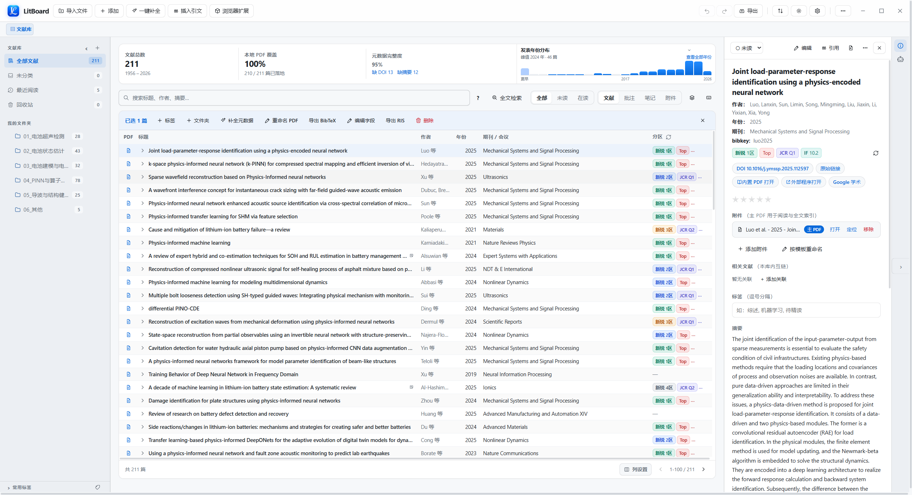
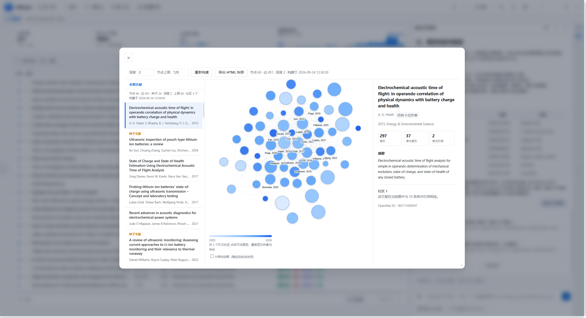
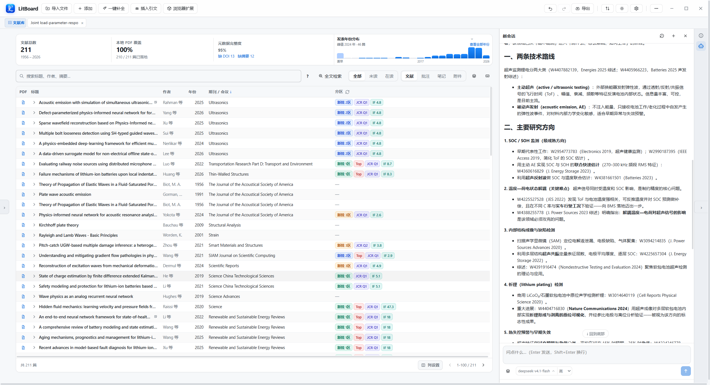
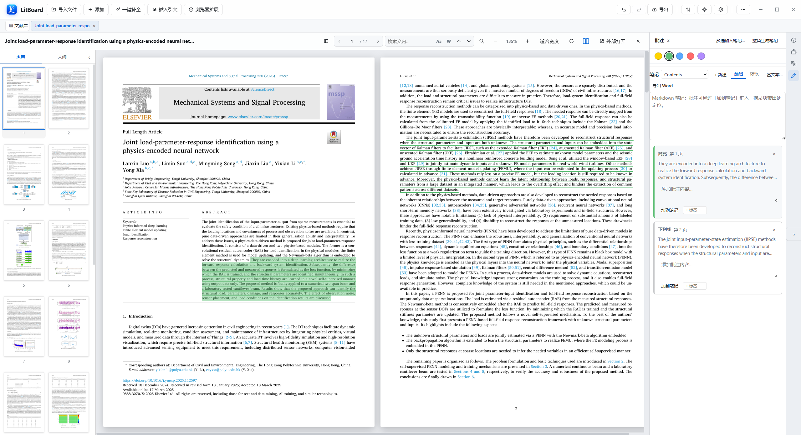
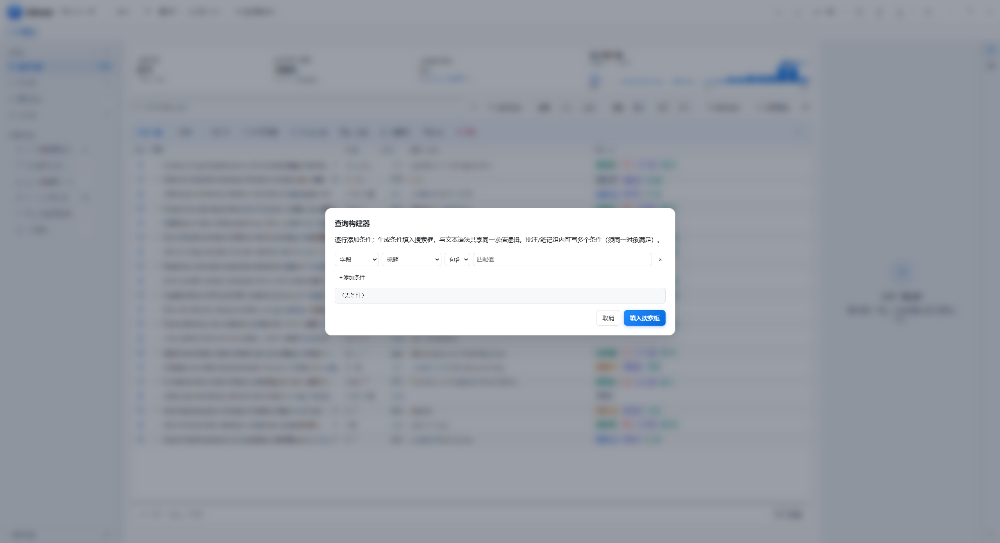
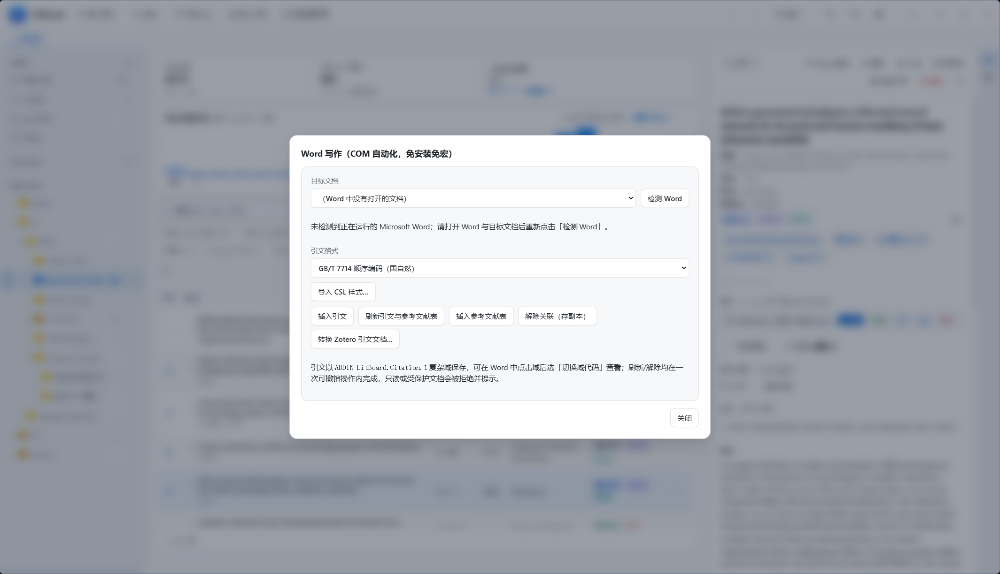

<div align="center">


# LitBoard

**以 AI 助手为核心的本地文献管理与调研工作台**

[English](README.md) · **简体中文** · [功能导览](docs/feature-tour.md) · [下载 Windows 版](https://github.com/L1nze/LitBoard/releases)

[](LICENSE)
[](#开始使用)

</div>

LitBoard 在 Windows 中集成本地文献库、PDF / EPUB 阅读、引用管理与 AI 调研。坚果云同步和模型服务按需配置。

## 界面预览

浅色主题示例：AI 对话和引文网络来自测试会话，其余使用演示数据。点击查看原图。

<table>
  <tr>
    <td width="33.3%" align="center"><a href="docs/assets/screenshots/library.png"></a><br><strong>文献库与详情</strong></td>
    <td width="33.3%" align="center"><a href="docs/assets/screenshots/citation-graph.png"></a><br><strong>引文网络分析</strong></td>
    <td width="33.3%" align="center"><a href="docs/assets/screenshots/agent.png"></a><br><strong>AI 助手</strong></td>
  </tr>
  <tr>
    <td width="33.3%" align="center"><a href="docs/assets/screenshots/reader.png"></a><br><strong>内置阅读器</strong></td>
    <td width="33.3%" align="center"><a href="docs/assets/screenshots/search.png"></a><br><strong>组合检索</strong></td>
    <td width="33.3%" align="center"><a href="docs/assets/screenshots/citation.png"></a><br><strong>插入引文</strong></td>
  </tr>
</table>

## 核心功能

- 导入文件、文件夹或 Zotero 本机资料库，检查重复项并保留本地修改。
- 阅读 PDF、EPUB 与网页快照，进行批注、笔记、OCR 和全文检索。
- 用 AI 按页读取、查找相关文献、核对证据、生成引文网络；视觉模型可查看 PDF 页面。
- 在 Word 中插入、更新 CSL 引文与参考文献表。
- 文献库本地保存，支持快照恢复和可选的坚果云 WebDAV 同步。

AI 调研库与主库分开，收藏文献须确认；模型凭据自行配置，在线工具会访问外部服务。未配置 AI 时仍可手动检索。调研设计参考导师的开源项目 [PAPER-SQL](https://github.com/galois-yan/PAPER-SQL)。

## 开始使用

从 [GitHub Releases](https://github.com/L1nze/LitBoard/releases) 下载 Windows x64 安装版或便携版，校验方法见[下载说明](docs/release.md)。打包版无需另装 Node.js。

1. 导入 PDF、BibTeX、RIS、CSL-JSON 或文件夹；Zotero 用户从「设置 → 集成与服务 → Zotero 本机资料库」启动向导。
2. 按需配置 AI 端点、模型和凭据；向量模型使用独立配置。
3. 在「数据与备份」设置快照位置；跨设备使用时配置坚果云 WebDAV。

文件夹导入支持 PDF、EPUB、DjVu、MOBI、AZW3、DOC、DOCX、ODT、RTF。拖到侧栏目标文件夹会归入该处，其他区域使用当前文件夹；操作演示见[功能导览](docs/feature-tour.md)。

浏览器采集：在 Chrome / Edge 开发者模式加载安装目录的 `resources/extension/` 或源码的 `extension/`，开启 LitBoard 顶栏「扩展」接收服务，将端口和令牌填入扩展选项。

## 数据与更新

默认数据目录为 `%APPDATA%\LitBoard`，可另选位置；快照支持恢复。更新在后台下载并校验 SHA-256，点击「立即更新」启动安装；便携版定位新文件供替换。当前构建未签名。

## 从源码运行

Node 要求与工具版本见 [package.json](package.json)。工具安装到仓库外的 `%LOCALAPPDATA%\LitBoardBuildTools`，项目内不放 `node_modules`。

```powershell
npm.cmd test
npm.cmd run lint
npm.cmd start
npm.cmd run dist:nobump
```

`npm run dist` 会递增 patch。开发步骤见[开发约定](docs/development.md)、[发布流程](docs/releasing.md)和[文档索引](docs/README.md)。

## 许可证与第三方组件

自有代码采用 [MIT](LICENSE)；MuPDF.js 采用 AGPL-3.0-or-later，其他随包组件保留各自条款。见[第三方清单](docs/THIRD-PARTY.md)。
