# 功能导览

安装与连接步骤见[项目说明](../README.zh-CN.md)。以下为五条常用流程。

## 文件夹导入

拖到侧栏目标文件夹，按目录结构导入并检查重复项；也可用菜单或文件夹右键导入。

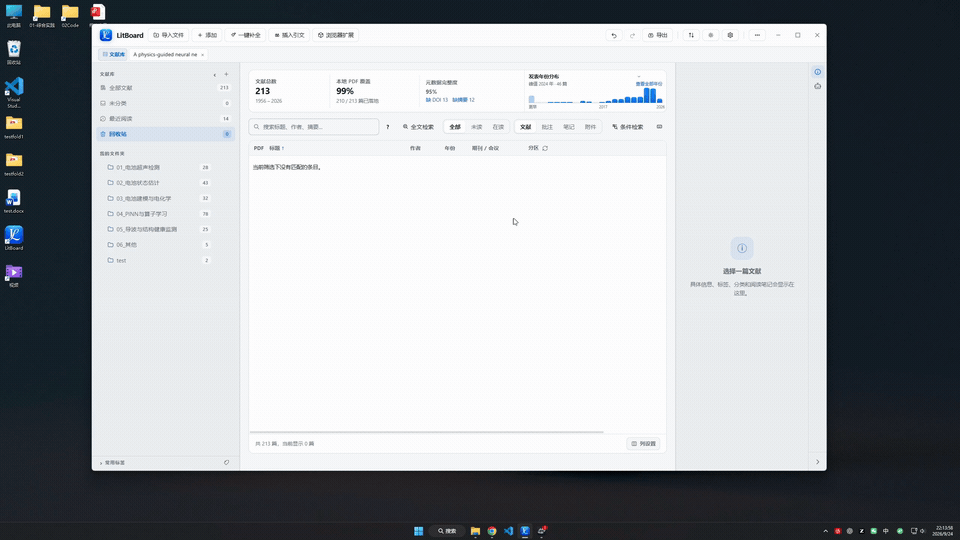

## 浏览器采集

开启顶栏「扩展」接收服务，用端口和令牌连接 Chrome / Edge 扩展，再从学术页面保存；字段取决于站点。

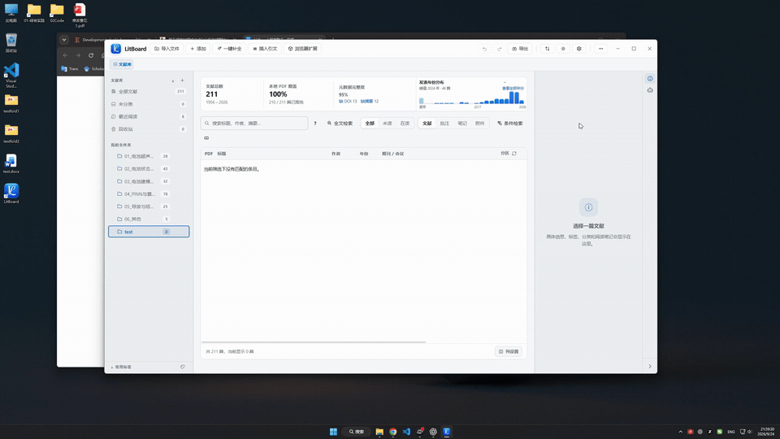

## PDF 辅助阅读

打开 PDF，在右侧 AI 面板提问；工具按需读取页面，视觉模型可查看图表。模型服务需配置，普通阅读不依赖 AI。

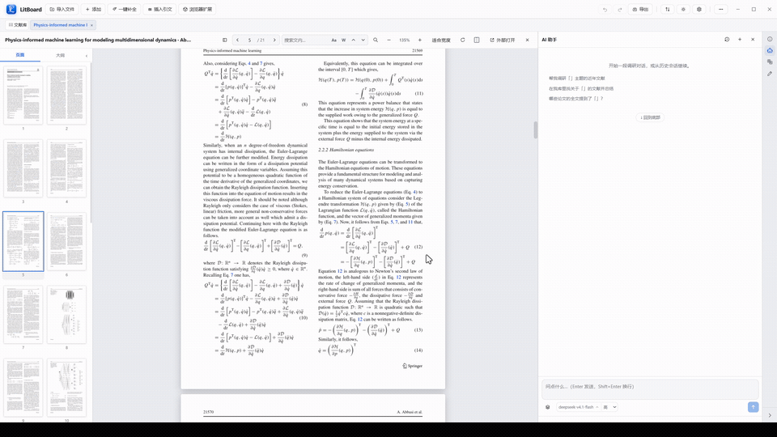

## Word 引用

在 Word 写作面板选择 CSL 样式与文献，插入引文及参考文献表。需安装本机 Word；元数据改正后刷新引用。

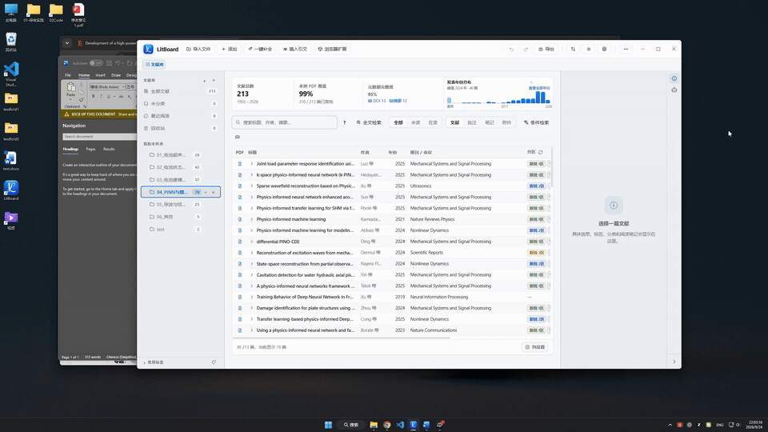

## AI 调研与引文图

输入研究问题，查看检索、证据与引文网络；结果收藏到主库前须确认。

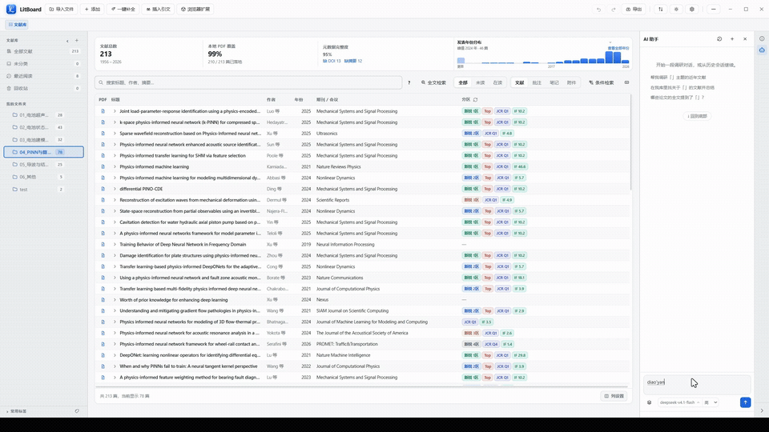

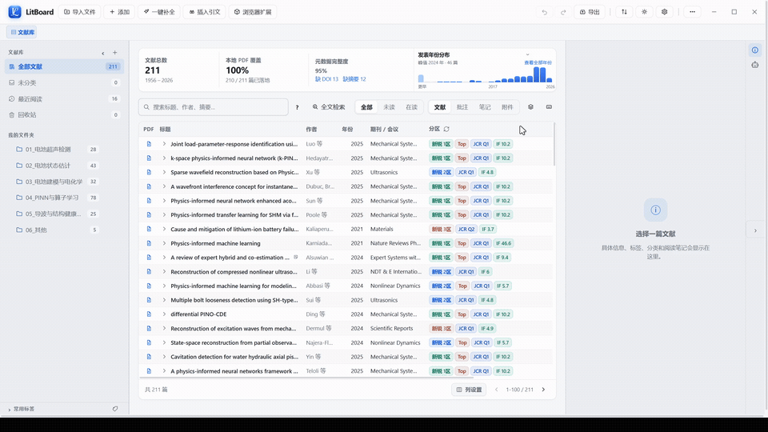

## 界面主题

每行对比同一编号的浅色与深色主题。点击缩略图可查看完整界面。

<table>
  <tr>
    <td width="50%" align="center"><a href="assets/theme/light1.png">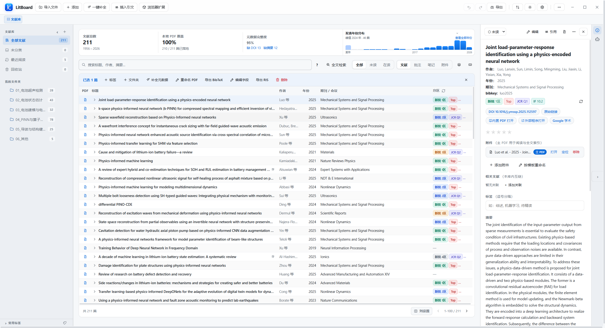</a> 浅色 1</td>
    <td width="50%" align="center"><a href="assets/theme/dark1.png">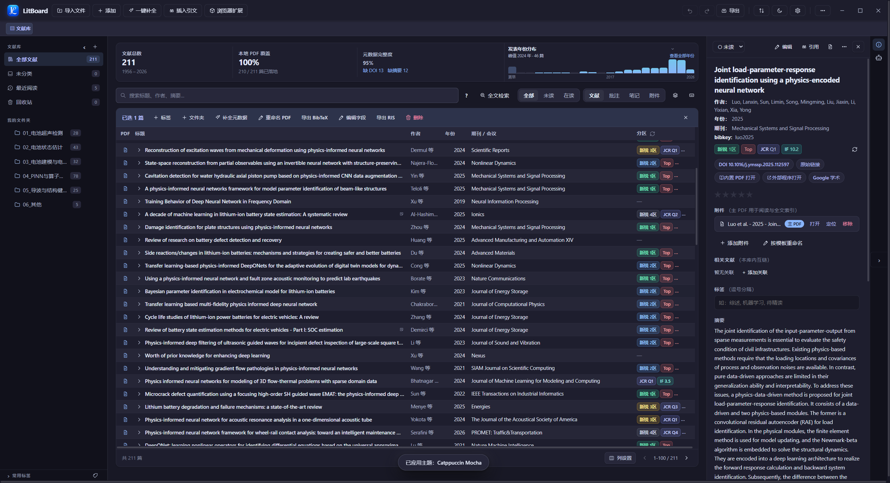</a> 深色 1</td>
  </tr>
  <tr>
    <td width="50%" align="center"><a href="assets/theme/light2.png">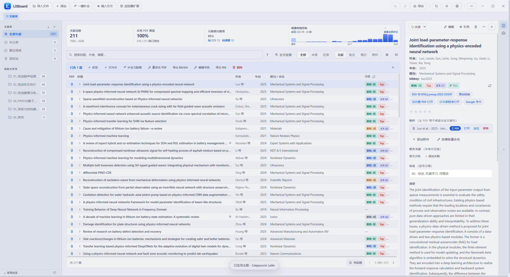</a> 浅色 2</td>
    <td width="50%" align="center"><a href="assets/theme/dark2.png">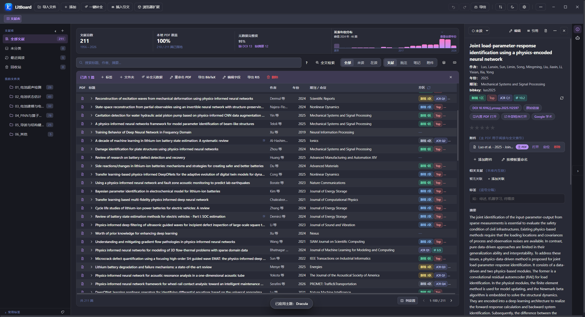</a> 深色 2</td>
  </tr>
  <tr>
    <td width="50%" align="center"><a href="assets/theme/light3.png">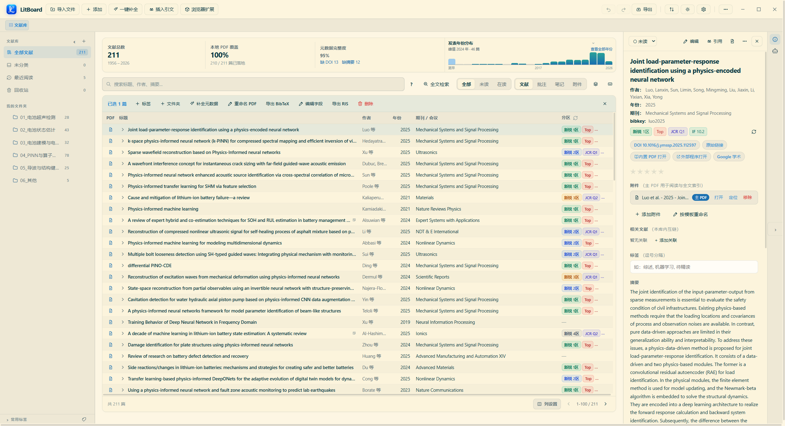</a> 浅色 3</td>
    <td width="50%" align="center"><a href="assets/theme/dark3.png">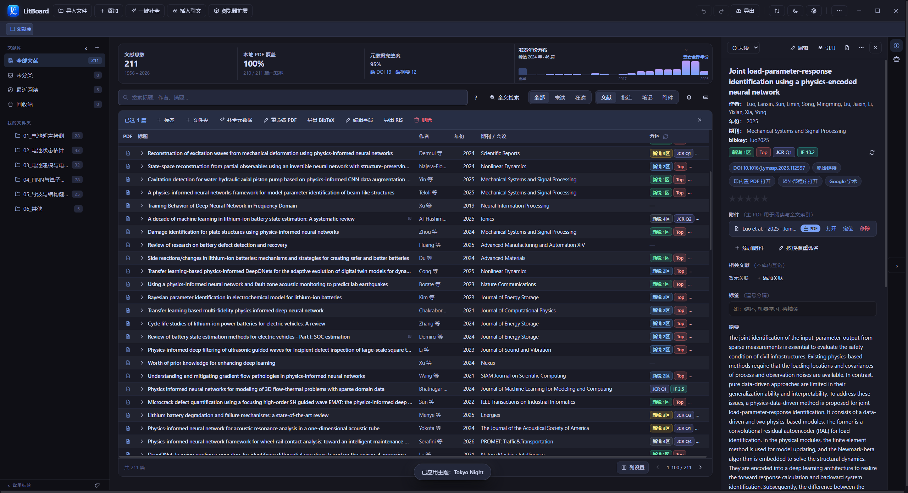</a> 深色 3</td>
  </tr>
  <tr>
    <td width="50%" align="center"><a href="assets/theme/light4.png">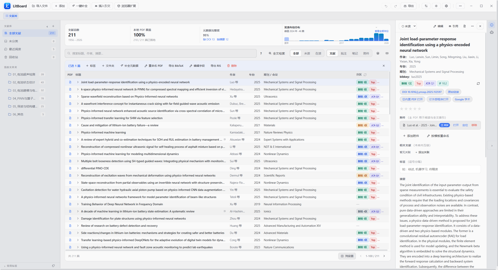</a> 浅色 4</td>
    <td width="50%" align="center"><a href="assets/theme/dark4.png">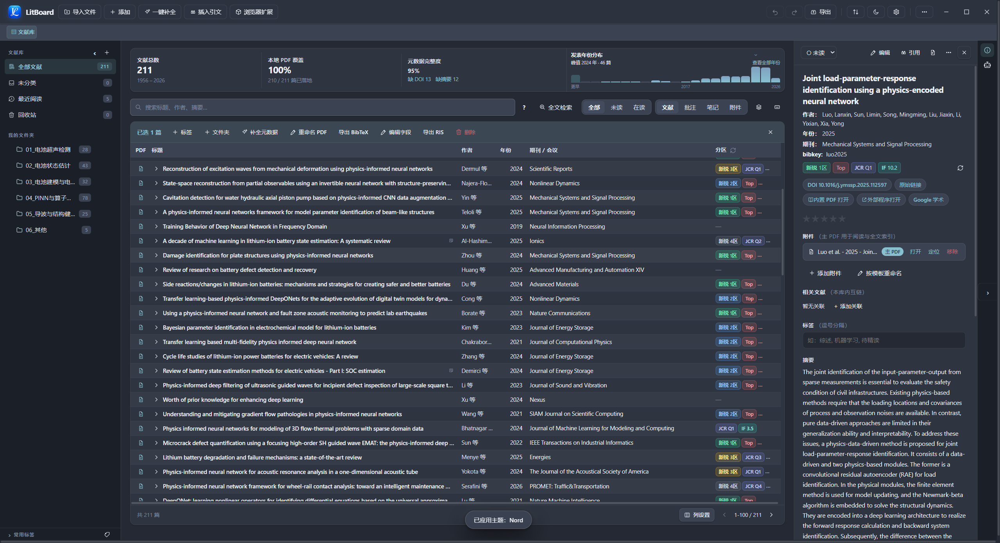</a> 深色 4</td>
  </tr>
  <tr>
    <td width="50%" align="center"><a href="assets/theme/light5.png">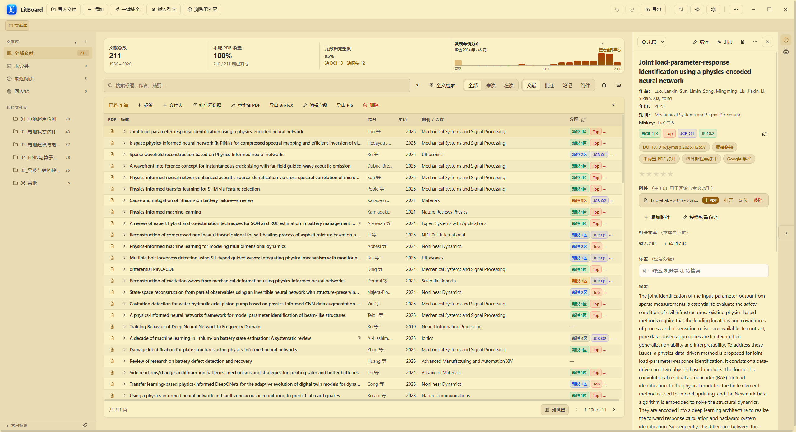</a> 浅色 5</td>
    <td width="50%" align="center"><a href="assets/theme/dark5.png">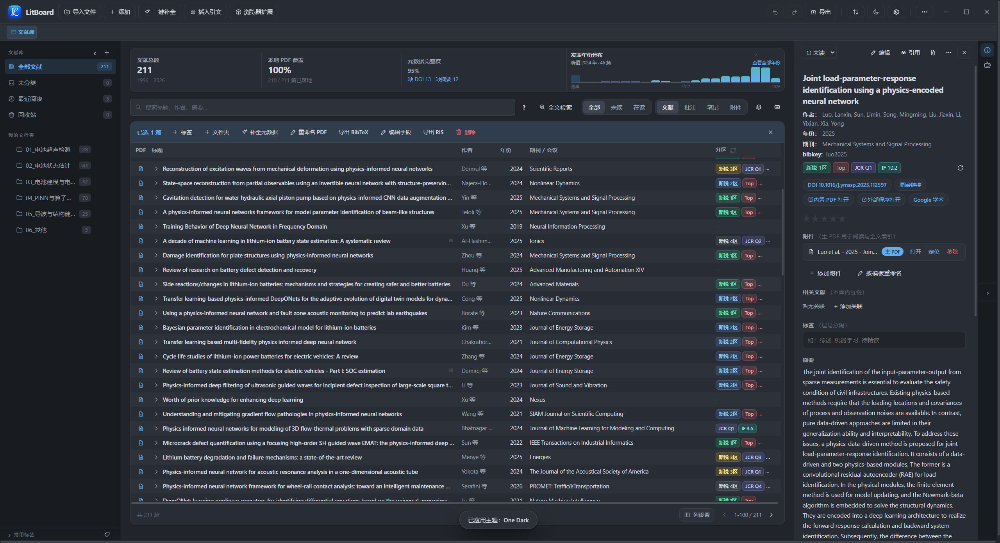</a> 深色 5</td>
  </tr>
</table>

更多功能和安装步骤见[项目说明](../README.zh-CN.md)及[发布与下载说明](release.md)。
